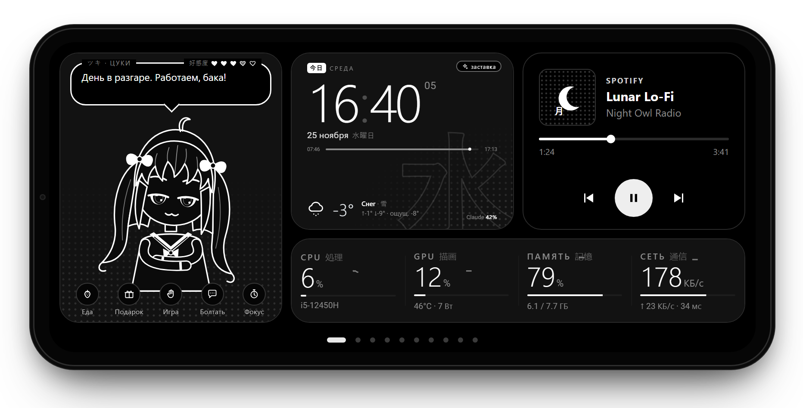
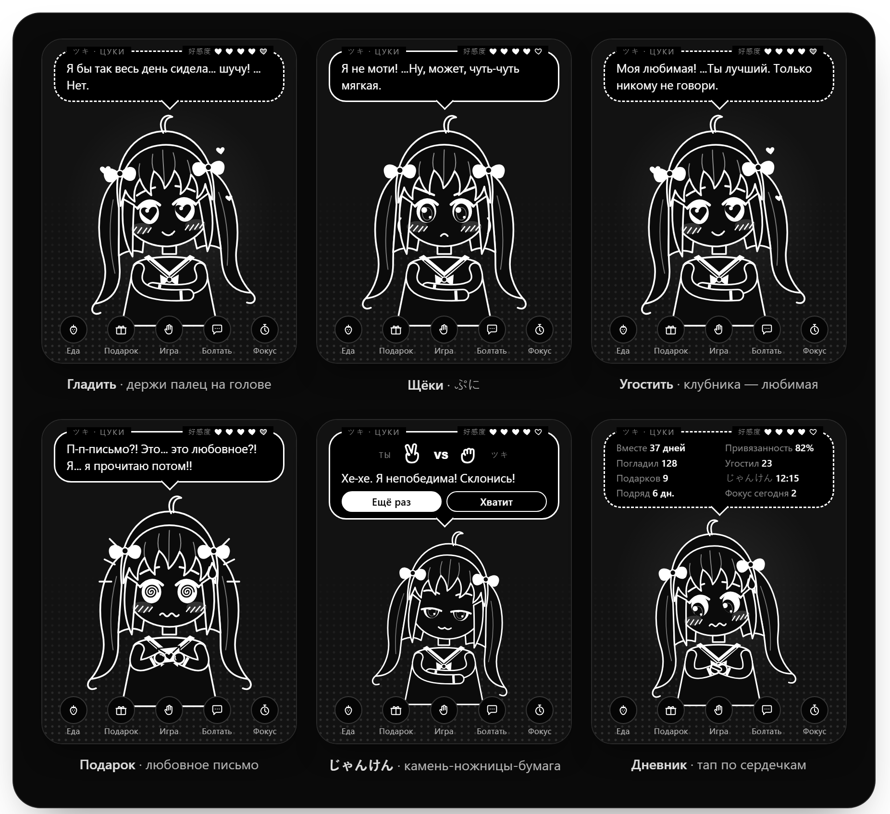
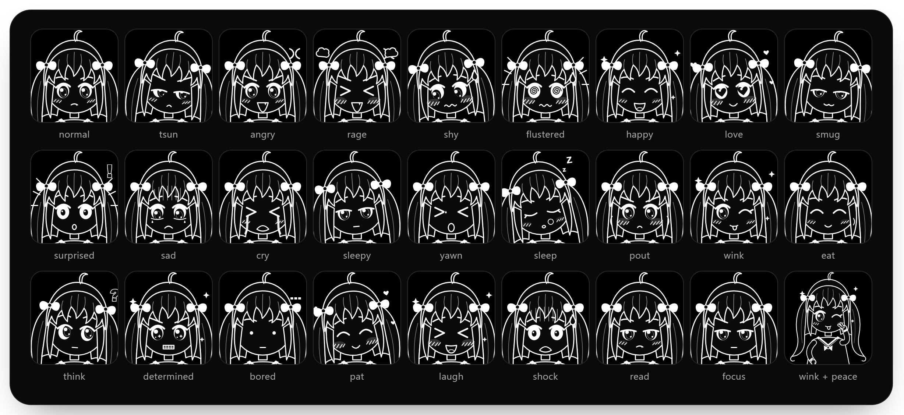
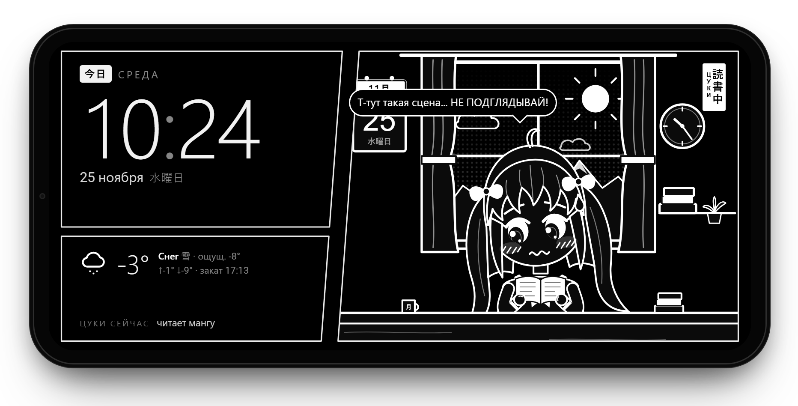
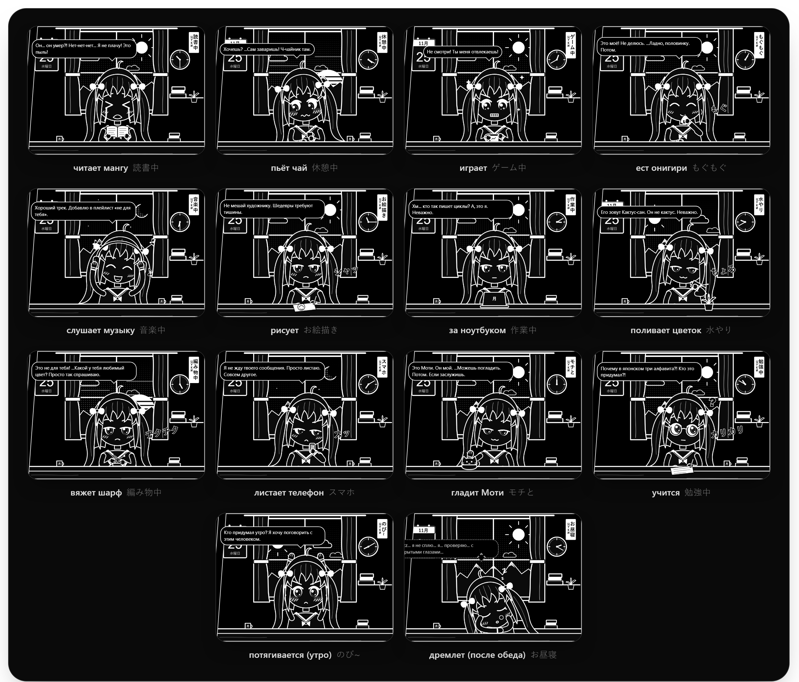
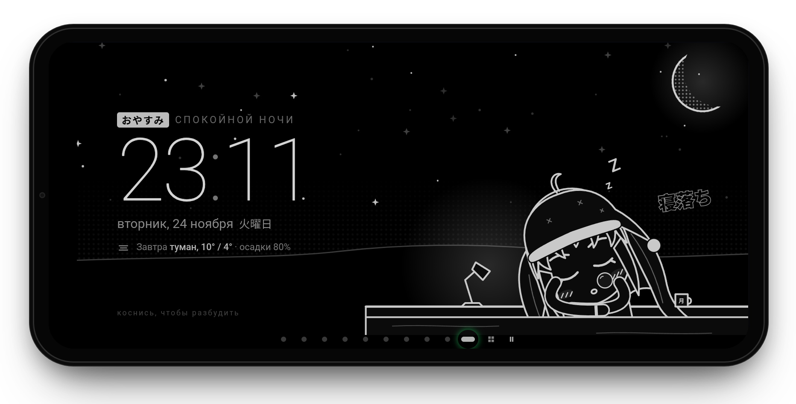
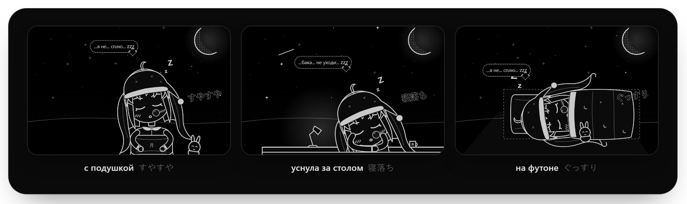
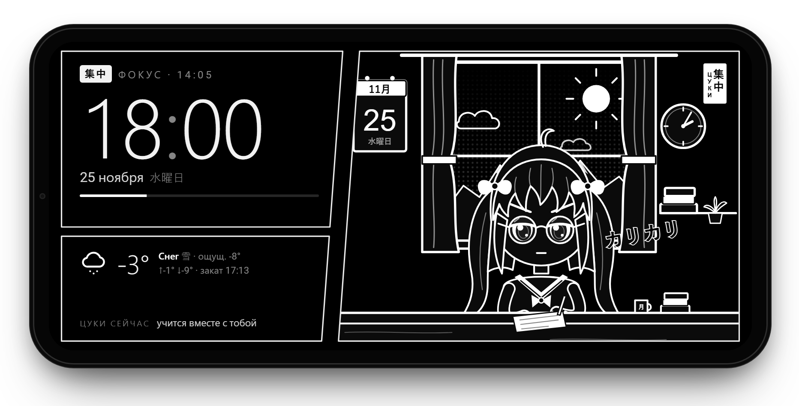
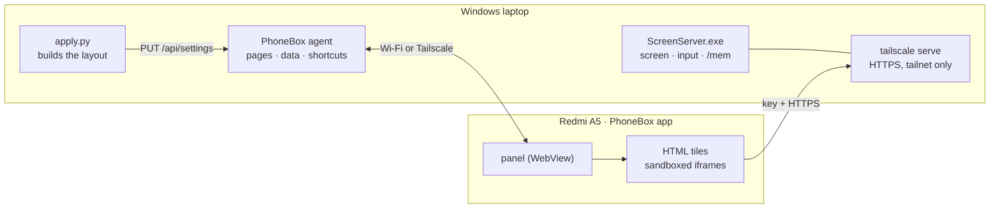

<p align="center">
  
</p>

<p align="center">
  
  
  
  
  
</p>

<p align="center"><b>English</b> · <a href="README.ru.md">Русский</a></p>

An old **Redmi A5** sits next to the laptop as a dedicated remote: a trackpad, keys, apps, power buttons, the live laptop
screen, system stats and Claude limits, in one black-and-white manga-style layout for [PhoneBox](#credits).

Living on it is **Tsuki (ツキ)**, an original tsundere drawn entirely in code. She reacts to *where* you touch her,
remembers you between days, eats, takes gifts, plays rock-paper-scissors, keeps you on a focus timer, and comments on
the laptop and the weather. When nobody is around she takes over the screen as a clock: busy with something different
every time by day, asleep from 20:00.

<p align="center">
  
  <br><sub>«Главная», the home page. Every picture here is rendered from the real tile code (<code>docs/render.py</code>), except the one marked as a phone screenshot.</sub>
</p>

**Contents:** [Meet Tsuki](#meet-tsuki) · [The idle screen](#the-idle-screen) · [How it works](#how-it-works) ·
[Running on a budget phone](#running-on-a-budget-phone) · [Getting started](#getting-started) ·
[Make it yours](#make-it-yours) · [Project structure](#project-structure) · [Credits](#credits)

## Meet Tsuki

She answers to where she is touched, and her eyes follow your finger.

| Touch | What she does |
|---|---|
| **Head**: hold ½ s, or rub back and forth | a head pat: hearts, affection grows; pat her long enough and she "melts" |
| **Ahoge**, the hair antenna | it springs back (ピョン), she protests |
| **Cheeks** | ぷに: she puffs them up |
| **Ribbons, twin tails** | gets angry; the tails jump |
| **Body** | tickling: she laughs, four in a row and she is mad |
| **Six pokes in six seconds** | offended: she ignores you for 15 seconds |

Under her is a dock:

<p align="center">
  
</p>

- **Еда (food)**: strawberries (her favourite), pudding, onigiri, tea, chocolate («это что, признание?!»), and green
  pepper, which is a crime. She takes it, eats it (もぐもぐ), then reacts. Five in ten minutes: «Я лопну!»
- **Подарок (gifts)**: a flower, a box, a plush bunny, manga, a love letter (spiral eyes), a rock.
- **Игра (game)**: rock-paper-scissors with a result card, a rematch button and a score she remembers.
- **Болтать (talk)**: twelve questions with two answers each; your answer changes how she feels.
- **Фокус (focus)**: a 25 / 50 minute timer and a break. She cheers you on, scolds you for poking her mid-focus, and
  counts today's sessions. The idle screen shows the countdown too.
- **Her notebook**: tap the hearts. Days together, pats, food, gifts, the score, your visit streak.

**Affection** (好感度, five hearts) grows with pats, food, gifts and kind answers, drops with spam, pepper and unkind
answers, and fades slowly while you are away. Four levels (tsun → cool → warm → dere) change what she says.
She also notices the laptop (CPU, memory, GPU temperature, downloads, ping), the music (she hums along), Claude limits
and Claude Code waiting for your answer, rain, snow and frost, lunch time, late nights, how long you were gone, and
your visit streak.

<p align="center">
  
  <br><sub>26 faces and 17 arm poses, all from one SVG rig.</sub>
</p>

## The idle screen

After five minutes without a touch the phone turns into a clock.

<p align="center">
  
</p>

**By day** it is a manga page: the clock, the weather and today's sunset, and a room with a window onto the mountains.
The sky in the window follows the real sunrise and sunset; the wall calendar and the wall clock show the real date and
time. **Every time the screen opens, Tsuki is doing something else**, never the same thing twice in a row. Every half a
minute or so she says something about it.

<p align="center">
  
</p>

**From 20:00** the clock dims, the stars come out, tomorrow's forecast appears, and Tsuki sleeps in pyjamas and a
night cap: hugging a pillow, at her desk under the lamp, or on a futon. She talks in her sleep (sweeter when she likes
you more; after 1 a.m. she tells you to go to bed). If the screen is on at 20:00 she yawns, insists she is not sleepy
at all, and falls asleep; at 07:00 the alarm wakes her.

<p align="center">
  
  <br><sub>A real screenshot from the phone, taken over adb.</sub>
</p>

<p align="center">
  
</p>

While the **focus timer** runs, the clock becomes a countdown with a progress bar and she studies with you, in glasses.
A tap anywhere: she reacts, and the panel goes back to the home page.

<p align="center">
  
</p>

## How it works



- **PhoneBox** (a separate project: a Windows agent and an Android app) shows pages of widgets on the phone. This repo
  does not modify it; `apply.py` writes the layout through the agent's local API and keeps every other setting.
- **Each custom tile is HTML in a sandboxed iframe.** It receives data through `window.phonebox`
  (`state`, `weather`, `quotas`, `work`) and may run a shortcut or switch pages. Nothing else.
- **Tsuki's memory** cannot use `localStorage` in that sandbox, so it lives in a small `/mem` endpoint on the screen
  server (one JSON object, written atomically). The home tile writes it, the idle screen reads it: that is how the idle
  screen knows about the focus timer and how much she likes you.
- **The screen server** (C# 5, built by the `csc.exe` that ships with Windows) also streams the laptop screen to the
  «Экран» page and takes mouse and keyboard input. It listens on localhost only and needs a key.

### The rig

Tsuki is one SVG-building script, [`tiles/lib/tsuki.js`](phonebox/tiles/lib/tsuki.js), shared by both tiles.

- **Faces are slots.** Eyes (15 kinds), mouths (17), brows (4), blush (3 levels) and effects (18) are drawn once and
  switched by attributes. `rig.mood('flustered')` is one attribute change, so one repaint.
- **Arms are tubes.** Each arm is a stroked curve from shoulder to elbow to hand, with a cuff and a hand shape, so a
  pose is two pairs of points: `{ L: [50, 230, 90, 214, 'fist'], R: [...] }`.
- **Props follow hands.** `{ k: 'cup', at: 'R' }` puts the cup in her right hand, wherever that hand is.
- **An activity is a few such frames** stepped by a timer, plus things she says:

```js
{ id: 'tea', ru: 'пьёт чай', jp: '休憩中', m: 'normal', ms: 1300,
  fr: [{ p: CUP, pr: [{ k: 'cup', at: 'R' }] },               // holding the cup
       { p: SIP, m: 'happy', f: { m: 'flat' }, sfx: 'ズズ…' }],  // a sip, eyes closed
  ev: [{ m: 'smug', say: 'Чай остывает, пока ты тут пялишься.' }] }
```

## Running on a budget phone

The Redmi A5 (Android 15 Go, Unisoc, Mali GPU, 2.8 GB) needs about 20 ms to draw one WebView frame. An earlier version
of this layout kept it at 100 % CPU, because endless CSS animations asked for 60 frames a second, and taps got lost.
So everything here is built around a frame budget:

- **No endless animation.** Blinks, glances and activity frames are single attribute swaps from a JS timer, about one
  repaint a second. CSS animations (the bubble pop, katakana, hearts) run only for a moment after a touch.
- **Layers.** On the idle screen the scenery with its patterns and masks, the stars, and Tsuki each get a compositing
  layer. Chrome on Android rasterises a layer in full-width strips, so with one shared layer a twinkling star redrew the
  masks and her outlines in that strip: **105 ms per step, now 27 ms**.
- **Off screen, nothing runs.** Every tile checks whether it is visible before doing any work.

Measured on the phone over adb, against the previous version of this layout, same protocol for both:

| Page | before (CPU: app + WebView, frames) | after |
|---|---|---|
| A page with nothing animated (baseline) | 3.8 % + 5.6 % | 3.1 % + 5.3 % |
| Home, 6 s after opening | 81 % + 71 %, 558 frames / 12 s | 24 % + 20 %, 114 frames / 12 s |
| Home, 70 s without a touch | 34 % + 23 %, 219 frames / 20 s | 20 % + 16 %, 137 frames / 20 s |
| Night screen | 9 % + 13 %, 81 ms per frame | 12 % + 14 %, 27 ms per frame |

## Getting started

You need:

- a Windows laptop with the **PhoneBox agent** and an Android phone with the **PhoneBox app**, paired;
- **Python 3.10+** (standard library only);
- optional: **Tailscale** (the laptop screen and Tsuki's memory), **Edge or Chrome** (to re-render the images),
  **adb** (phone screenshots).

```powershell
git clone https://github.com/Raul12-bit/phonebox-tsuki.git
cd phonebox-tsuki
copy phonebox\config.example.json phonebox\config.json
```

1. **Look first.** `python -I -X utf8 phonebox/apply.py --preview` writes every tile with sample data to
   `phonebox/preview/`. Serve it with `python -m http.server 8811 -d phonebox/preview` and open
   `http://localhost:8811`. Add `?t=21:30` to a tile's address for another time of day, `?act=tea` to pick a scene,
   or open `rig.html` to see every face, pose and prop.
2. **Screen server** (optional, for the «Экран» page and Tsuki's memory):
   `powershell -ExecutionPolicy Bypass -File phonebox\screen-server\install.ps1`, then `tailscale serve --bg 8790`,
   and put the `https://<laptop>.<tailnet>.ts.net` address into `screen_base` in `config.json`.
3. **Apply.** `python -I -X utf8 phonebox/apply.py --dry-run` to check, then without `--dry-run` to write it to
   PhoneBox. Re-run it after every change; it keeps a backup of the previous settings.

The full manual (pages, the screen page, power controls, Tailscale, troubleshooting, measurements) is in
[`phonebox/README.md`](phonebox/README.md).

## Make it yours

- **`phonebox/config.json`**: the night hours, the idle delay, the weather location, the screen server's address.
- **What she says**: `TSUN`, `MID`, `DERE`, `ASK`, `FACTS`, `FOOD`, `GIFTS` in
  [`tiles/mascot.html`](phonebox/tiles/mascot.html); each activity's lines (`ev`) in
  [`tiles/idle.html`](phonebox/tiles/idle.html). She speaks Russian, with Japanese sound effects.
- **A new activity**: add it to `ACTS` in `tiles/idle.html` (the format is above), check it with `?act=<id>`.
- **A new prop**: add it to `PROPS` in `tiles/lib/tsuki.js`; `preview/rig.html` shows them all.
- **The README images**: `python -I -X utf8 docs/render.py` (`--device` also grabs the phone's screen over adb).

## Project structure

```text
phonebox/
├─ apply.py                 builds every page and button, writes them to PhoneBox; --preview, --dry-run
├─ config.example.json      your settings (copy to config.json, which git ignores)
├─ tiles/
│  ├─ lib/tsuki.js          the Tsuki rig: faces, poses, props
│  ├─ mascot.html           Tsuki on the home page: touch zones, dock, memory
│  ├─ idle.html             the idle screen: 14 day activities, 3 night scenes, focus
│  ├─ anime-clock.html      clock with kanji, daylight and weather
│  ├─ screen.html           the live laptop screen with touch, trackpad and keyboard modes
│  └─ …                     system strip, chart, details, Claude limits, power, screen button
├─ screen-server/           ScreenServer.cs (screen, input, /mem) and its installer
├─ phone/apps.ps1           turns distracting apps on the phone off and on (adb)
├─ fix/                     diagnostics for the MSIX AppData pitfall
└─ wallpaper/               Tsuki wallpapers for the laptop and the phone
docs/
├─ render.py                renders the images below from the tiles
├─ src/                     the pages it photographs
└─ img/                     the images in this README
```

## Credits

- **PhoneBox** (Android package `net.oxog.phonebox`) is a separate project by its own authors. This repository only
  builds a layout for it through its local API and contains none of its code.
- **Tsuki (ツキ)** is an original character, drawn in code; no third-party art is used.
- The weather comes from [Open-Meteo](https://open-meteo.com), fetched by PhoneBox.
