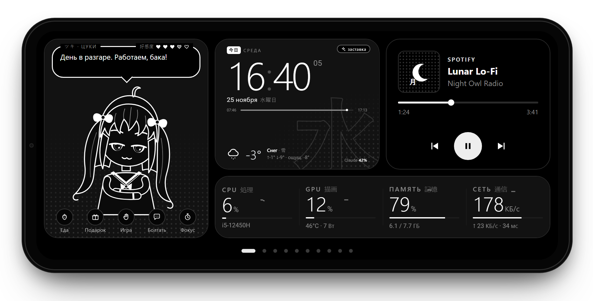
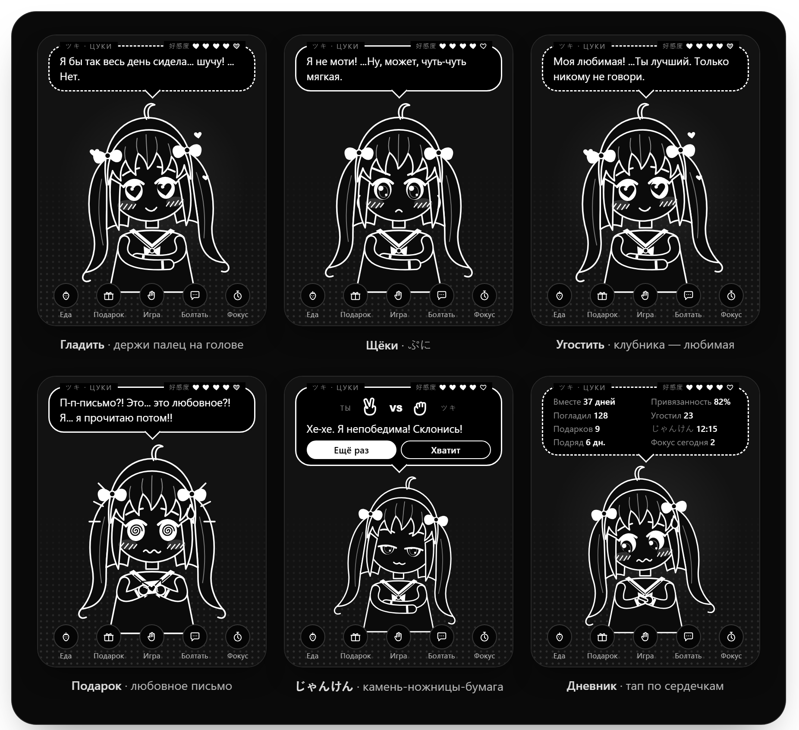
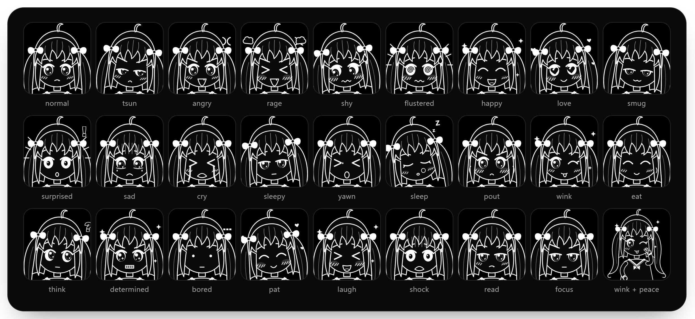
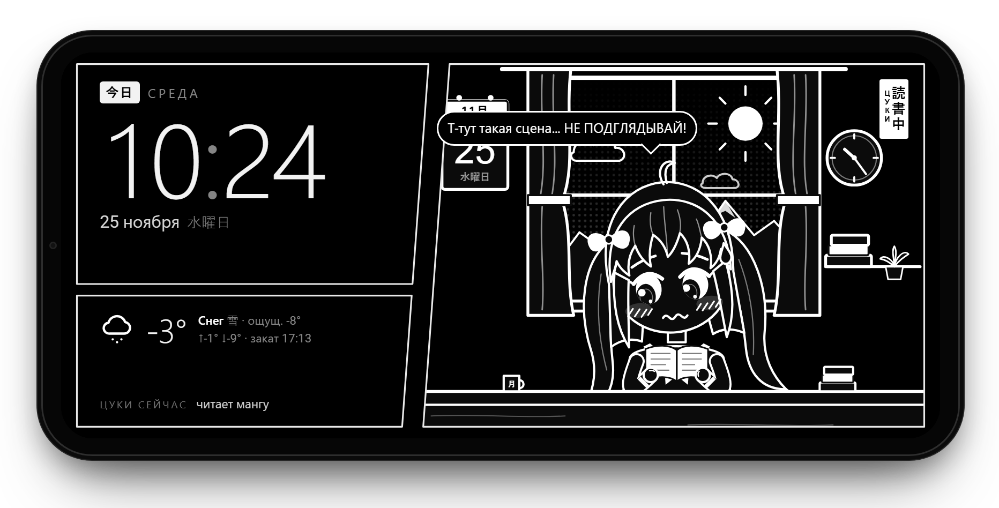
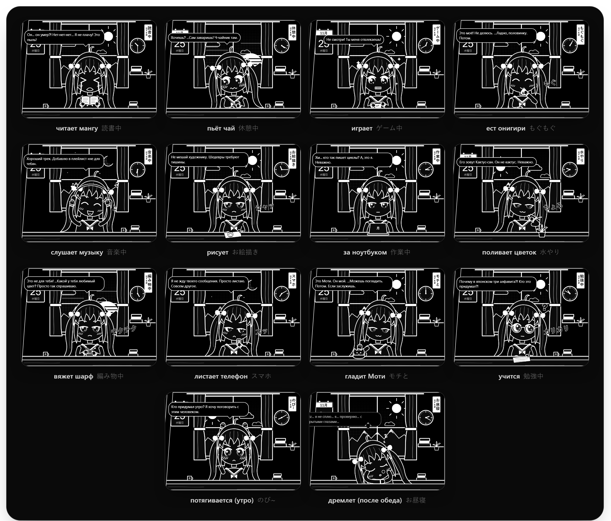
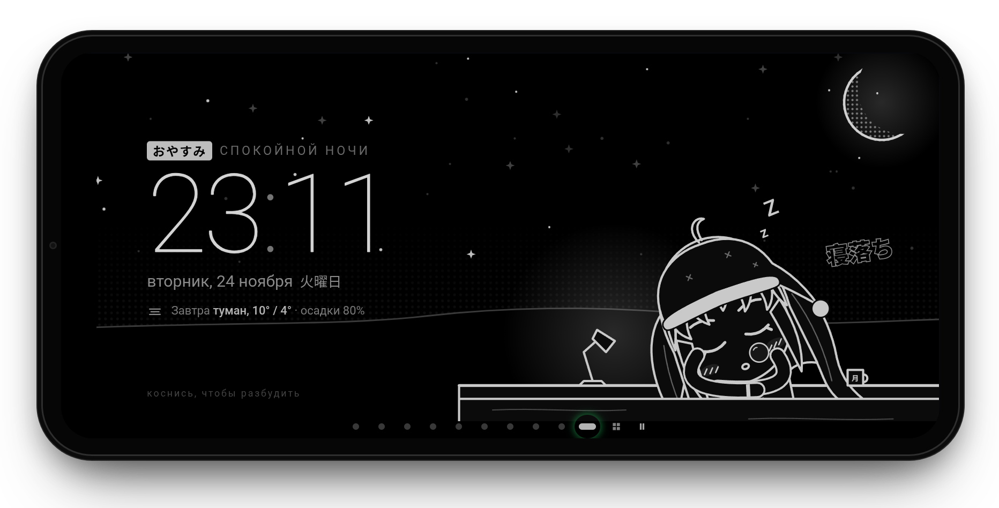
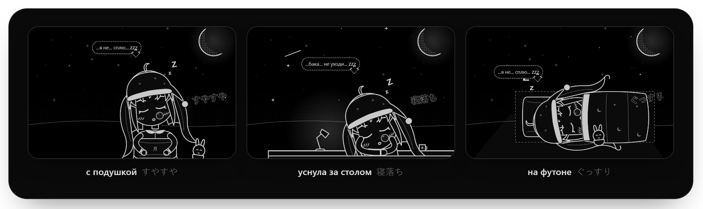
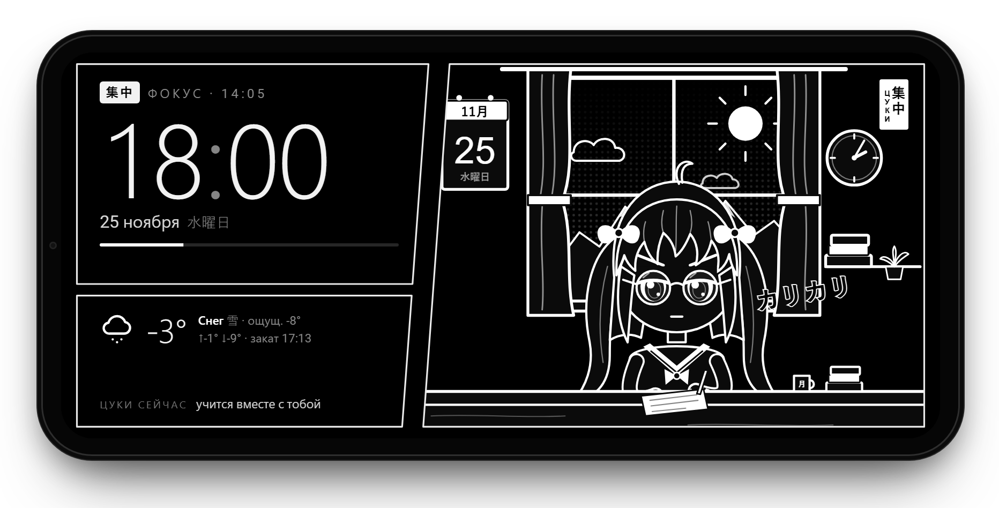
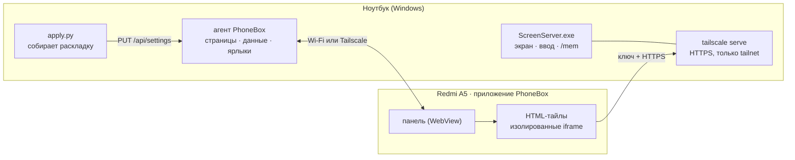

<p align="center">
  
</p>

<p align="center"><a href="README.md">English</a> · <b>Русский</b></p>

Старый **Redmi A5** живёт рядом с ноутбуком как отдельный пульт: тачпад, клавиши, приложения, кнопки питания, экран
ноутбука вживую, нагрузка системы и лимиты Claude — в одной чёрно-белой раскладке в стиле манги для
[PhoneBox](#благодарности).

На нём живёт **Цуки (ツキ)** — оригинальная цундере, полностью нарисованная кодом. Она реагирует на то, *куда* её
коснулись, помнит вас между днями, ест, принимает подарки, играет в камень-ножницы-бумагу, держит вас на фокус-таймере
и комментирует ноутбук и погоду. Когда никого нет, она превращает экран в часы: днём каждый раз занята чем-то новым,
с 20:00 спит.

<p align="center">
  
  <br><sub>«Главная». Все картинки здесь отрендерены из настоящего кода тайлов (<code>docs/render.py</code>), кроме помеченного скриншота с телефона.</sub>
</p>

**Содержание:** [Знакомьтесь, Цуки](#знакомьтесь-цуки) · [Заставка](#заставка) · [Как это работает](#как-это-работает) ·
[На слабом телефоне](#на-слабом-телефоне) · [Быстрый старт](#быстрый-старт) · [Под себя](#под-себя) ·
[Структура](#структура) · [Благодарности](#благодарности)

## Знакомьтесь, Цуки

Она отвечает на то, куда её коснулись, а глазами следит за пальцем.

| Касание | Что делает |
|---|---|
| **Голова**: удерживать ½ с или поглаживать | гладить: сердечки, привязанность растёт; погладишь долго — «тает» |
| **Хохолок** | пружинит (ピョン), она возмущается |
| **Щёки** | ぷに: надувает щёки |
| **Бантики, хвостики** | злится, хвостики подпрыгивают |
| **Тело** | щекотка: смеётся, четыре раза подряд — злится |
| **Шесть тычков за шесть секунд** | обижается и 15 секунд вас игнорирует |

Под ней — панель действий:

<p align="center">
  
</p>

- **Еда**: клубника (любимая), пудинг, онигири, чай, шоколад («это что, признание?!») и зелёный перец — это
  преступление. Берёт, ест (もぐもぐ), реагирует. Пятое угощение за десять минут — «Я лопну!»
- **Подарок**: цветок, коробка, плюшевый зайка, манга, любовное письмо (глаза-спирали), камень.
- **Игра**: камень-ножницы-бумага с карточкой результата, реваншем и счётом, который она помнит.
- **Болтать**: двенадцать вопросов по два ответа; от ответа зависит её настроение.
- **Фокус**: таймер на 25 / 50 минут и перерыв. Подбадривает, ругается, если тыкаете её во время фокуса, считает
  сессии за день. Заставка тоже показывает обратный отсчёт.
- **Дневник**: тап по сердечкам. Сколько дней вместе, сколько гладили, кормили, дарили, счёт в игре, серия визитов.

**Привязанность** (好感度, пять сердечек) растёт от поглаживаний, еды, подарков и добрых ответов, падает от спама,
перца и грубых ответов и медленно угасает, пока вас нет. Четыре уровня (цун → прохладно → тепло → дере) меняют её
реплики. Ещё она замечает ноутбук (процессор, память, температуру видеокарты, загрузки, пинг), музыку (подпевает),
лимиты Claude и Claude Code, ждущий ответа, дождь, снег и мороз, обед, поздний час, сколько вас не было и серию визитов.

<p align="center">
  
  <br><sub>26 эмоций и 17 поз рук — всё из одного SVG-рига.</sub>
</p>

## Заставка

Через пять минут без касаний телефон превращается в часы.

<p align="center">
  
</p>

**Днём** это страница манги: часы, погода и время заката, а рядом комната с окном на горы. Небо в окне меняется по
настоящему восходу и закату, календарь и часы на стене показывают реальные дату и время. **При каждом открытии Цуки
занята чем-то новым** и никогда не повторяется два раза подряд. Примерно раз в полминуты она что-то говорит об этом.

<p align="center">
  
</p>

**С 20:00** часы тускнеют, появляются звёзды и прогноз на завтра, а Цуки спит в пижаме и колпаке: в обнимку с подушкой,
за столом под лампой или на футоне. Разговаривает во сне (нежнее, когда вы ей нравитесь; после часа ночи гонит вас
спать). Если в 20:00 экран включён, она зевает, уверяет, что совсем не хочет спать, — и засыпает. В 07:00 её будит
будильник.

<p align="center">
  
  <br><sub>Настоящий скриншот с телефона, снятый через adb.</sub>
</p>

<p align="center">
  
</p>

Пока идёт **фокус-таймер**, вместо часов — обратный отсчёт с полосой прогресса, а Цуки в очках учится вместе с вами.
Тап в любом месте: она реагирует, и панель возвращается на «Главную».

<p align="center">
  
</p>

## Как это работает



- **PhoneBox** (отдельный проект: агент для Windows и приложение для Android) показывает на телефоне страницы виджетов.
  Этот репозиторий его не меняет: `apply.py` записывает раскладку через локальный API агента и не трогает остальные
  настройки.
- **Каждый свой тайл — HTML в изолированном iframe.** Данные приходят через `window.phonebox`
  (`state`, `weather`, `quotas`, `work`); тайл может запустить ярлык или переключить страницу. Больше ничего.
- **Память Цуки.** В такой песочнице нет `localStorage`, поэтому память хранится в маленьком эндпоинте `/mem` на
  сервере экрана (один JSON-объект, атомарная запись). Пишет её тайл на «Главной», читает заставка — так она узнаёт
  про фокус-таймер и про то, насколько вы нравитесь Цуки.
- **Сервер экрана** (C# 5, собирается встроенным в Windows `csc.exe`) ещё и транслирует экран ноутбука на страницу
  «Экран» и принимает мышь и клавиатуру. Слушает только localhost и требует ключ.

### Риг

Цуки — один скрипт, строящий SVG: [`tiles/lib/tsuki.js`](phonebox/tiles/lib/tsuki.js), общий для обоих тайлов.

- **Лицо из слотов.** Глаза (15 видов), рты (17), брови (4), румянец (3 уровня) и эффекты (18) нарисованы один раз и
  переключаются атрибутами. `rig.mood('flustered')` — одна смена атрибута, одна перерисовка.
- **Руки — трубки.** Каждая рука — кривая плечо → локоть → кисть с манжетой и формой кисти, поэтому поза — это две пары
  точек: `{ L: [50, 230, 90, 214, 'fist'], R: [...] }`.
- **Предметы следуют за руками.** `{ k: 'cup', at: 'R' }` кладёт чашку в правую руку, где бы та ни была.
- **Занятие — несколько таких кадров** по таймеру плюс её реплики:

```js
{ id: 'tea', ru: 'пьёт чай', jp: '休憩中', m: 'normal', ms: 1300,
  fr: [{ p: CUP, pr: [{ k: 'cup', at: 'R' }] },               // держит чашку
       { p: SIP, m: 'happy', f: { m: 'flat' }, sfx: 'ズズ…' }],  // глоток, глаза закрыты
  ev: [{ m: 'smug', say: 'Чай остывает, пока ты тут пялишься.' }] }
```

## На слабом телефоне

Redmi A5 (Android 15 Go, Unisoc, GPU Mali, 2.8 ГБ) рисует один кадр WebView примерно за 20 мс. Ранняя версия этой
раскладки держала его на 100 % CPU: бесконечные CSS-анимации требовали 60 кадров в секунду, и касания терялись.
Поэтому всё здесь построено вокруг бюджета кадров:

- **Никаких бесконечных анимаций.** Моргание, взгляды и кадры занятий — одна смена атрибута по JS-таймеру, примерно одна
  перерисовка в секунду. CSS-анимации (всплывающий пузырь, катакана, сердечки) идут только мгновение после касания.
- **Слои.** На заставке декорации с узорами и масками, звёзды и сама Цуки получают отдельные композитные слои. Chrome на
  Android растеризует слой полосами во всю ширину, и с одним общим слоем мигающая звезда перерисовывала маски и контуры
  в своей полосе: **было 105 мс на шаг, стало 27 мс**.
- **Вне экрана ничего не работает.** Каждый тайл сначала проверяет, виден ли он.

Замерено на телефоне через adb, против предыдущей версии раскладки, одинаковым способом:

| Страница | было (CPU: приложение + WebView, кадры) | стало |
|---|---|---|
| Страница без анимаций (база) | 3.8 % + 5.6 % | 3.1 % + 5.3 % |
| «Главная», 6 с после открытия | 81 % + 71 %, 558 кадров / 12 с | 24 % + 20 %, 114 кадров / 12 с |
| «Главная», 70 с без касаний | 34 % + 23 %, 219 кадров / 20 с | 20 % + 16 %, 137 кадров / 20 с |
| Ночной экран | 9 % + 13 %, 81 мс на кадр | 12 % + 14 %, 27 мс на кадр |

## Быстрый старт

Понадобятся:

- ноутбук с Windows и **агентом PhoneBox**, телефон на Android с **приложением PhoneBox**, сопряжённые;
- **Python 3.10+** (только стандартная библиотека);
- по желанию: **Tailscale** (экран ноутбука и память Цуки), **Edge или Chrome** (перерисовать картинки),
  **adb** (скриншоты с телефона).

```powershell
git clone https://github.com/Raul12-bit/phonebox-tsuki.git
cd phonebox-tsuki
copy phonebox\config.example.json phonebox\config.json
```

1. **Посмотреть.** `python -I -X utf8 phonebox/apply.py --preview` собирает все тайлы с примерными данными в
   `phonebox/preview/`. Запустите `python -m http.server 8811 -d phonebox/preview` и откройте
   `http://localhost:8811`. `?t=21:30` в адресе тайла — другое время суток, `?act=tea` — выбрать сцену, `rig.html` —
   все лица, позы и предметы.
2. **Сервер экрана** (по желанию, для «Экрана» и памяти Цуки):
   `powershell -ExecutionPolicy Bypass -File phonebox\screen-server\install.ps1`, затем `tailscale serve --bg 8790`,
   и адрес `https://<ноутбук>.<tailnet>.ts.net` — в `screen_base` в `config.json`.
3. **Применить.** `python -I -X utf8 phonebox/apply.py --dry-run` для проверки, затем без `--dry-run` — запись в
   PhoneBox. Запускайте после каждого изменения; предыдущие настройки сохраняются в резервную копию.

Полное руководство (страницы, экран ноутбука, питание, Tailscale, проблемы и замеры) — в
[`phonebox/README.md`](phonebox/README.md) (на английском).

## Под себя

- **`phonebox/config.json`**: ночные часы, задержка заставки, город для погоды, адрес сервера экрана.
- **Что она говорит**: `TSUN`, `MID`, `DERE`, `ASK`, `FACTS`, `FOOD`, `GIFTS` в
  [`tiles/mascot.html`](phonebox/tiles/mascot.html); реплики занятий (`ev`) — в
  [`tiles/idle.html`](phonebox/tiles/idle.html).
- **Новое занятие**: добавьте в `ACTS` в `tiles/idle.html` (формат выше), проверьте через `?act=<id>`.
- **Новый предмет**: добавьте в `PROPS` в `tiles/lib/tsuki.js`; `preview/rig.html` показывает все.
- **Картинки README**: `python -I -X utf8 docs/render.py` (`--device` ещё и снимает экран телефона через adb).

## Структура

```text
phonebox/
├─ apply.py                 собирает страницы и кнопки, пишет их в PhoneBox; --preview, --dry-run
├─ config.example.json      ваши настройки (скопируйте в config.json, git его игнорирует)
├─ tiles/
│  ├─ lib/tsuki.js          риг Цуки: лица, позы, предметы
│  ├─ mascot.html           Цуки на «Главной»: зоны касаний, панель, память
│  ├─ idle.html             заставка: 14 дневных занятий, 3 ночные сцены, фокус
│  ├─ anime-clock.html      часы с кандзи, световым днём и погодой
│  ├─ screen.html           экран ноутбука с режимами касания, тачпада и клавиатуры
│  └─ …                     система, график, детали, лимиты Claude, питание, кнопка экрана
├─ screen-server/           ScreenServer.cs (экран, ввод, /mem) и установщик
├─ phone/apps.ps1           выключает и включает отвлекающие приложения на телефоне (adb)
├─ fix/                     диагностика ловушки с MSIX AppData
└─ wallpaper/               обои с Цуки для ноутбука и телефона
docs/
├─ render.py                рендерит картинки для README из тайлов
├─ src/                     страницы, которые он фотографирует
└─ img/                     картинки README
```

## Благодарности

- **PhoneBox** (пакет Android `net.oxog.phonebox`) — отдельный проект своих авторов. Этот репозиторий только собирает
  для него раскладку через локальный API и не содержит его кода.
- **Цуки (ツキ)** — оригинальный персонаж, нарисованный кодом; чужая графика не используется.
- Погода — от [Open-Meteo](https://open-meteo.com), её запрашивает PhoneBox.
